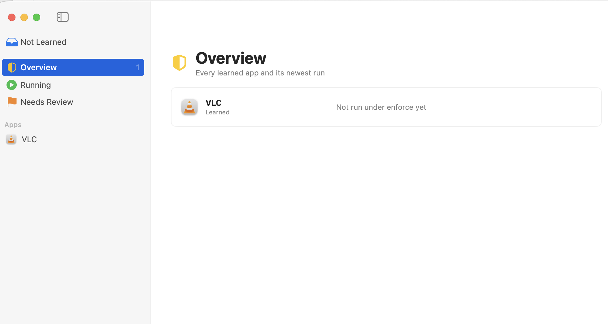
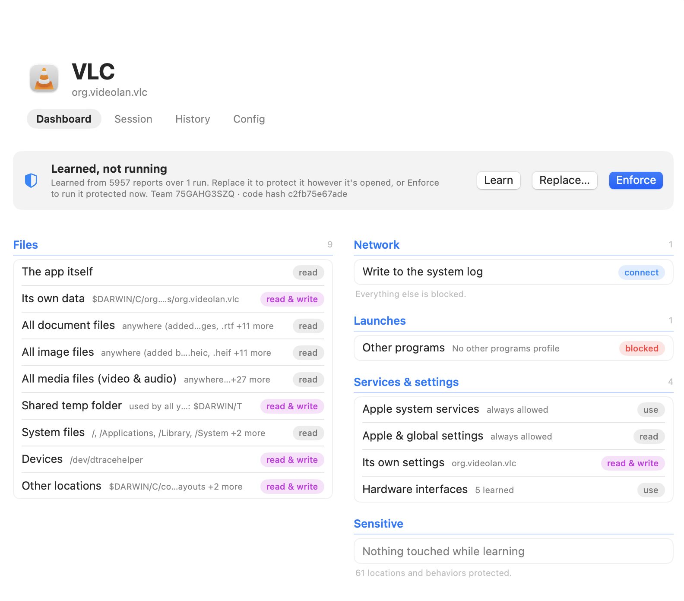
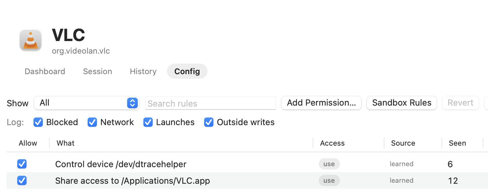
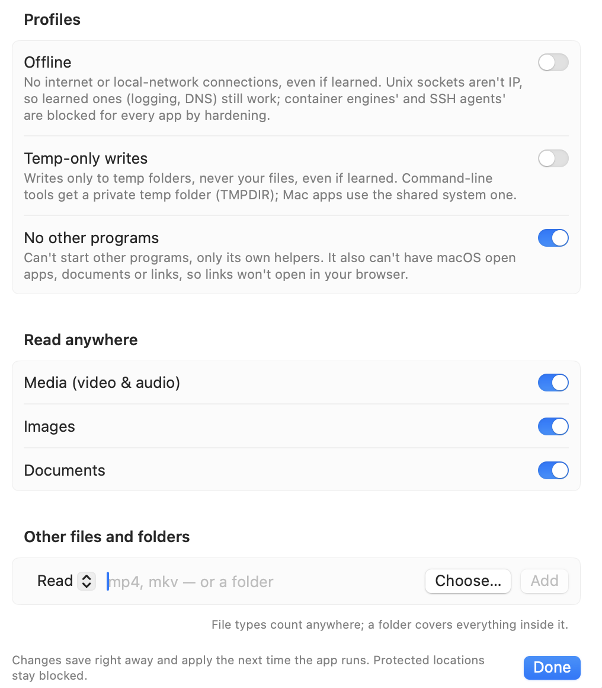

# Menshen

Menshen (門神, "door god") locks a Mac app inside Seatbelt, the sandbox engine underneath Apple's App Sandbox, using only what the app actually needs.

1. **Learn:** run the app once and use it normally. Menshen records everything it does.
2. **Enforce:** run it again under a deny-by-default profile built from what it learned. Credentials, other apps' data and startup items stay blocked even if the app touched them while learning.
3. **Replace** (optional): swap the app for a launcher with the same name and icon, so it always runs protected, however you open it. **Restore** puts it back.

No root needed. Tested on macOS 27.0.1.

| Overview | Dashboard |
|---|---|
|  |  |
| **Config** | **Add Permission** |
|  |  |

## Get started

```sh
./scripts/build-app.sh          # builds build/Menshen.app (no Xcode needed)
open build/Menshen.app
```

1. Add an app with **+**, or drop it on the sidebar.
2. Click **Learn**, use the app the way you normally would, then quit it.
3. Check the **Dashboard**: what it may access, in plain words.
4. Click **Enforce** to run it protected, or **Replace…** to make that permanent.

To change what an app may do after learning, open **Config → Add Permission…**: go offline, allow writes only to temp folders, block other programs, read media or documents anywhere, add your own file types or folders, or set CPU and memory limits.

Prefer the terminal?

```sh
swift build -c release
.build/release/menshen learn   /Applications/VLC.app   # use the app, then quit it
.build/release/menshen enforce /Applications/VLC.app
```

## Good to know

- **Learning protects nothing.** The app runs with everything allowed while it's learned, so learn only apps you trust that far, and review the result.
- **Some apps can't be wrapped:** apps that already use App Sandbox, and Apple's own apps. Menshen tells you before it tries.
- **It guards against a compromised app, not a compromised account.** Other programs running as you can still change Menshen's configs.

More: [Overview](Overview.md) (command line, how it works, all known limits) · [Changelog](docs/CHANGELOG.md) · [Decisions](docs/DECISIONS.md)
